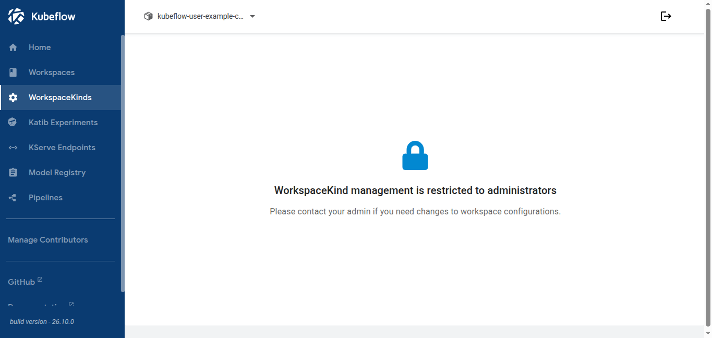
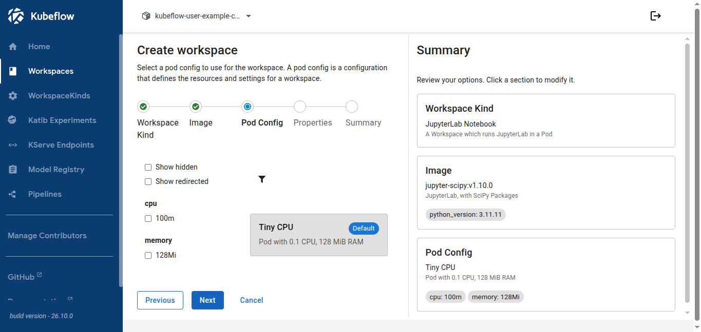
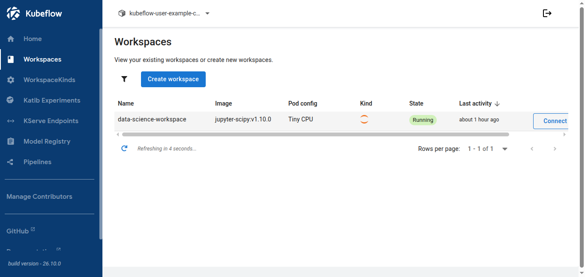
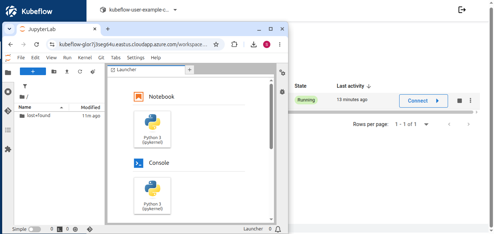

Kubeflow Workspaces 2.0.0 (Notebooks v2) provides on-demand development
environments that run inside the Kubernetes cluster. On AKS, platform teams can
publish a stable catalog of supported environments, while data scientists and ML
engineers create and use them through a guided workflow.

## Environment catalog

A `WorkspaceKind` describes an environment that the platform team makes
available. It can define services such as JupyterLab, approved software images,
compute configurations, and the options users are allowed to select.

A `Workspace` is the user's instance of one of those environments.

This separation lets platform teams control what is offered without requiring
users to configure Kubernetes Pods directly. Kubernetes RBAC, admission
controls, namespace policy, and the underlying AKS platform remain the actual
security and enforcement boundaries.

## Create a Workspace

Creating a Workspace starts with choices that are meaningful to the user:
environment, software image, and compute configuration.

The resulting Workspace retains those choices as declarative configuration. A
running Workspace shows the selected image and compute configuration and exposes
the services associated with the environment.

Selecting **Connect** on a JupyterLab Workspace opens the JupyterLab service for
that Workspace.

## Platform capabilities

1. **Governed environments.** Administrators maintain `WorkspaceKind` resources
   as a stable catalog of supported environments, software images, compute
   choices, and services. Users create Workspaces from that catalog.

2. **Guided creation.** Users choose meaningful software and compute options
   instead of assembling Kubernetes Pod specifications themselves.

3. **Mutable environments.** Workspaces retain declarative configuration, so
   supported settings can be edited after creation instead of requiring every
   change to start from a new environment.

4. **Context-aware choices.** Filter Rules can control which WorkspaceKinds and
   options are relevant or available in a particular context.

5. **Safe platform evolution.** Option Redirects give administrators an explicit
   path from older software or compute selections to supported replacements
   instead of silently changing a running Workspace.

6. **Activity-driven resource governance.** Activity Rules can pause inactive
   Workspaces when configured, providing a way to reclaim unused interactive
   compute, including expensive accelerator capacity.

7. **A gateway to Kubernetes-native AI infrastructure.** A Workspace runs inside
   the Kubernetes environment, so it can serve as the interactive development
   surface alongside systems such as Kubeflow Trainer and Spark Operator, and
   separately deployed Kubernetes services such as KubeRay, subject to the
   cluster's access and networking policies.

## Who it's for

- **Data scientists and ML engineers** get a faster path from an approved
  software stack to a working development environment without needing to manage
  Kubernetes primitives directly.
- **Research and robotics teams** can give multiple users repeatable development
  environments while keeping software and compute choices consistent.
- **Platform and infrastructure engineers** get a controlled catalog they can
  evolve over time while retaining control of AKS identity, networking, storage,
  scheduling, policy, and accelerator capacity.

Kubeflow Workspaces gives ML users practical development environments while
letting platform teams keep software, compute, and lifecycle choices under
administrative control.
